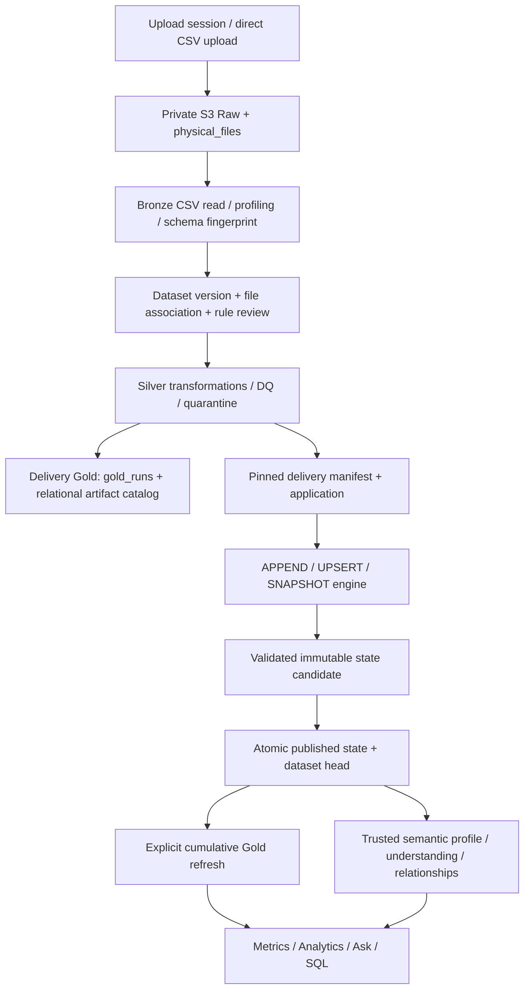
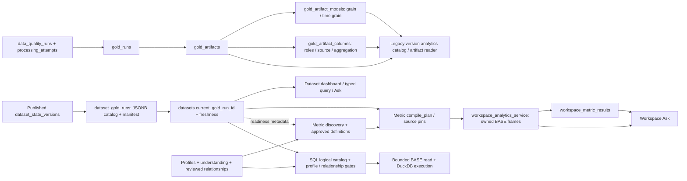

# Phase 11 — BigQuery warehouse architecture

Design review dated 2026-10-21. Source baseline: `20519270fc3ae8303f145e73407294df7c56f992` (Model UX); authentication/ownership baseline: `e73081e`. Status: proposed architecture, not implementation approval. No cloud resources, dependencies, migrations, or application changes accompany this document.

## 1. Current architecture audit

Source code, rather than prior phase reports, is the authority for the observations below. Root `AGENTS.md` was read in full. Existing test deletions, reports, tools, screenshots, and the modified Phase 8A HTML fixture are unrelated and must remain untouched. The application source inspected is tracked and has no local application edits in the initial status.

| Boundary | Existing implementation and persistence |
|---|---|
| Authentication/ownership | `app/auth/{middleware,service,repository}.py`; endpoint dependencies in `app/api/identity.py`; scope checks in `services/processing_context_service.py` and `workspace_understanding_service.py`. Resource ownership authorizes access; uploader identity remains provenance. |
| Upload | `api/files.py`, `services/file_service.py`, `services/upload_session_service.py`; `db/{file,upload_session,dataset}_repository.py`; `physical_files`, `upload_requests`, users/workspaces/datasets. Physical SHA-256 deduplication is distinct from logical delivery identity. |
| Physical processing | `services/processing_service.py:start_processing`, `processing/bronze_processor.py:run_bronze_stage`; `processing_attempts`, `dataset_profiles`, `dataset_profile_summary`, schema fingerprints and `dataset_versions` / `dataset_version_files`. |
| Rules/Silver | `services/{business_rule,rule_reuse,delivery_execution}_service.py`, `processing/{silver_processor,silver_transformer,silver_validator}.py`; `business_rules`, `approved_rule_policies`, `data_quality_runs`, `data_quality_issues`. Approved rule snapshots and successful attempts gate application. |
| Source application | `services/{incremental_application,append_application,incremental_policy,snapshot_context,dataset_processing}_service.py`; `processing/{append,upsert,snapshot}_engine.py`, `row_identity.py`; `dataset_load_policies`, `delivery_applications`, `delivery_manifests`, `dataset_state_versions`, `datasets.current_state_id`. |
| Delivery Gold | `processing/{gold_processor,gold_planner,gold_mart_builder,gold_catalog_builder}.py`, `services/processing_service.py:run_gold_processing`; `gold_runs`, `gold_artifacts`, `gold_artifact_models`, `gold_artifact_columns`. |
| Cumulative Gold | `services/dataset_analytics_service.py`, `processing/cumulative_gold.py`, `storage/cumulative_gold_artifacts.py`; `dataset_gold_runs`, `datasets.current_gold_run_id`, `state_analytics_status`. Catalog is JSONB, not the delivery artifact tables. |
| Semantic evidence | `services/{dataset_profile,dataset_understanding,workspace_understanding,relationship,metric}_service.py`; repositories for semantic profiles/suggestions, workspace semantics, relationships and metrics. `semantic_profiles`, `semantic_column_evidence`, `semantic_suggestions`, `workspace_semantic_suggestions`, `relationship_discovery_runs`, `relationship_candidates`, `relationship_reviews`, `metric_discovery_runs`, `metric_candidates`, `metric_candidate_dependencies`, `metric_reviews`, `approved_metric_definitions`. |
| Consumers | `services/{analytics,workspace_analytics,workspace_question,sql_catalog,sql_analytics}_service.py`; `processing/{metric_execution,workspace_question_execution,workspace_question_resolution,sql_validation,sql_execution,sql_inputs,sql_policy}.py`; `workspace_metric_results`, `workspace_answers`, `saved_sql_queries`, `sql_query_executions`. |

The SQL baseline is distributed across `app/db/schema.sql` and migrations, not represented completely by the three original tables in `schema.sql`. Migrations 0004–0006 define delivery Gold metadata; 0013–0017 add state/application/cumulative Gold; 0018–0025 add semantic evidence, relationships, metrics, answers and SQL. Migration 0027 and pending ownership-adoption migration are existing context, not numbering to reuse.

Processing is currently coordinated through request-invoked Python services, PostgreSQL transactions and advisory session locks. `delivery_lock` detects abandoned attempts and records `CRASHED`; dataset locks serialize source applications; analytics refresh has a separate lock and compare-and-swap publication. SQL uses a process-local semaphore and a disposable spawned DuckDB process. These are not a durable distributed warehouse job queue. Do not assume a Lambda request can host an arbitrarily long warehouse load.

Existing typed contracts live in `app/schemas/{incremental,business_rules,metrics,relationships,workspace_questions,sql_analytics,analytics_query,ai_query_plan}.py`; business runtime plans include `MetricExecutionPlan` and `SqlPlan` dataclasses rather than ORM entities in `app/models`. The API/service/repository split and direct psycopg SQL should remain. Workspace consumer API roots are `/workspaces/{workspace_id}/metrics` (discovery/reviews), `/analytics` (readiness/refresh/per-metric retry), `/questions` (ask/readiness/answer history/refresh), `/sql` (catalog/validate/execute/builder/saved queries/history), and `/model-summary` (read-only model projection). Dataset analytics exposes dashboard/readiness/refresh/ask/query under its dataset scope.

## 2. Current pipeline flow

`files.py` exposes `/files/upload`, `/initiate`, `/complete`, `/uploads/{upload_id}/process`, `/processing-context`, `/continue`, rule approval/finalization and Silver/Gold processing routes. The presigned session path currently requires a plain `.csv` filename; Bronze uses `pd.read_csv`. Excel sheet/table discovery is an ingestion direction, not implemented by this path.

Dataset-scoped `/workspaces/{workspace_id}/datasets/{dataset_id}/incremental` provides policy creation, application preparation, delivery application and snapshot context. `continue_processing` runs Silver, optionally applies the selected incremental policy, then delivery Gold depending on the requested stage. Cumulative Gold refresh is separate at the dataset analytics `/refresh` endpoint. Do not confuse delivery Gold completion with current-state analytics freshness.

`prepare_application` pins upload, schema version, policy, rule version and successful DQ run. `delivery_manifest` copies the exact successful Silver business columns to an immutable application prefix with checksums. `apply_incremental` loads incoming and current frames, runs the selected pure engine, writes and validates candidate artifacts, then `_publish_metadata` atomically publishes state, updates the dataset head and completes the application. Head comparison requires `previous_state_id` to match. A retry after committed success returns that success.

Source state versions are per-dataset sequence values; failed candidates can occupy versions. Authoritative traversal follows the published `previous_state_id` chain, not an assumption of contiguous integers or globally ordered application IDs.

| Current S3 artifact | Meaning |
|---|---|
| `raw/{file_hash}/{file_name}` | Physical source identity; promotion from owned temporary upload staging. |
| `bronze/file_id={id}/data.parquet` | Physical-file Bronze output; stable path, not attempt-versioned immutable storage. |
| `silver/dataset_version_id={id}/file_id={id}/rule_version={v}/data.parquet` | Successful Silver stage output; stable rule-scoped path. |
| `quarantine/dataset_version_id={id}/file_id={id}/rule_version={v}/data.parquet` | DQ rejects, written when nonempty. |
| `silver/dataset_id=…/dataset_version_id=…/delivery/upload_request_id=…/application_id=…/manifest-{uuid}/` | Immutable copied delivery Parquet + JSON manifest. |
| `silver/dataset_id=…/dataset_version_id=…/state/application_id=…/candidate-{uuid}/` | Full candidate `data.parquet`, `outcomes.json`, `manifest.json`; hashes registered in PostgreSQL. |
| `gold/base/dataset_version_id=…/file_id=…/rule_version=…/data.parquet` and mart outputs | Legacy delivery Gold; `process_gold` uses stable paths despite its attempt-specific comment. |
| `gold/dataset_id=…/state_id=…/run_id=…/candidate-{uuid}/` | Cumulative immutable BASE/MART Parquet plus checksummed manifest and source dependencies. |

Immutability is strongest at the pinned delivery/state/cumulative prefixes (`IfNoneMatch='*'`), not at every legacy stage output. Future warehouse input must use immutable pins, never repeatedly resolve a mutable Silver path.

## 3. Current Gold dependency graph

There are separate `gold_run_id` namespaces in `gold_runs` and `dataset_gold_runs`; cumulative catalog artifact IDs are local ordinals, not `gold_artifacts` primary keys. Provider-aware references must include their namespace.

`analytics_service._read_artifact` supports both checksum-bearing cumulative entries and legacy entries. Current dataset catalog resolution favors trusted cumulative state; workspace consumers explicitly load cumulative BASE only with no delivery fallback. Cumulative Gold's `BASE`/`MART` classification and column roles `DIMENSION`/`MEASURE` are not warehouse FACT/DIMENSION/SCD model definitions.

Metric discovery is primarily grounded in current profiles, structural/semantic signatures and confirmed relationships; it gathers Gold status too. Execution additionally requires successful Gold matching the current state and `FRESH`. Approved definitions are immutable; changed data may stale a result without invalidating its definition. `compile_plan` pins dataset/state/Gold IDs, structural and semantic keys and relationship versions. Workspace analytics resolves each metric separately and records individual failures, preserving partial success. Ask either reuses a metric result or executes a safe ad hoc typed plan against the same bounded BASE reader. SQL pins state, Gold and profile plus relationship versions, validates again after computation and at result publication; history becomes stale when signatures change.

## 4. Reusable components

Reuse authenticated scope checks, repository transactions, dataset/application lineage, versioned approved policies, deterministic typed row normalization, schema fingerprints, checksummed manifests, advisory lock conventions, current-source signature checks, reviewed relationship evidence and failure categories. Reuse `MetricExecutionEngine` as the execution seam, typed metric/Ask schemas, SQLGlot AST validation concepts, saved queries/history and typed scalar serialization. Keep DuckDB for bounded local parity and development.

Reuse patterns, not assumptions: current identity normalization intentionally equates numeric representations and rejects naive timestamps; its exact version must be pinned. Existing APPEND may operate without keys, but a warehouse fact requires a declared event/grain identity. Current metric/SQL join support is narrower than arbitrary composite warehouse relationships.

## 5. Components requiring change

Add warehouse metadata and an execution adapter; do not extend `dataset_gold_runs` into an ambiguous warehouse run table. Add a versioned accepted-change manifest contract at source publication. Current UPSERT/SNAPSHOT outcome ledgers store hashes/row ordinals and selected context, not a complete warehouse CDC payload. APPEND retains reject rows and duplicate counts rather than an accepted-row ledger. SNAPSHOT absence-generated deactivations need explicit events. Thus existing manifests are replay inputs, not an already complete incremental warehouse feed.

Update compiler/catalog/provider resolution, not approved formulas, when introducing warehouse reads. Current `read_frames`, pandas metric execution, profile building and full-state cumulative Gold cannot scale by merely switching a connection string. Add an independent bounded source-processing improvement phase for large ingestion; BigQuery alone does not fix Bronze/Silver/source-state bottlenecks.

## 6. PostgreSQL responsibilities

Keep users, auth sessions, ownership/adoption records, workspaces, datasets, file/delivery references, contracts/load policies, processing attempts, rule/DQ metadata, trusted state heads, semantic evidence, reviewed relationships, approved metric definitions and all current history. Add warehouse configuration/versions, server-only physical resource mappings, runs/attempts, checkpoints, operation requests, reconciliation summaries, publication heads, lineage edges, query policies, admission reservations, usage and audit metadata.

Use PostgreSQL for bounded coordination and metadata, not analytical row storage, SCD member allocation per row, full query result archives, warehouse fact tables or business aggregations. Preserve owner/workspace consistency through scoped foreign keys and transaction checks, matching existing migrations' style.

## 7. S3 responsibilities

Retain private immutable Raw, Bronze/Silver outputs, quarantine, pinned deliveries and processing artifacts, state manifests and source replay evidence. Preserve historical Gold during transition. New accepted-change chunks/manifests live under immutable dataset/application scope with schema/hash/row accounting; they carry private before/after business data as necessary and never enter AI prompts or logs. Retention must outlast required replay/backfill windows. Optional exchange artifacts are transient, not a replacement lake.

## 8. BigQuery responsibilities

Own analytical fact/dimension rows, warehouse transformation/staging, version/revision journals, approved serving relations, warehouse aggregations and analytical SQL. Server resolves all resources. Auth, secrets, ownership authority, source acceptance policies, raw delivery truth, PostgreSQL transactions and orchestration decisions must not move to BigQuery. BigQuery is not a replacement for S3 or the application control plane.

DuckDB remains a bounded/local execution adapter. A public production deployment must not silently fall back to local full-data execution when warehouse governance rejects a request.

## 9. Warehouse metadata design

Follow the repository's plural snake_case tables, `BIGSERIAL` metadata IDs, scoped IDs, explicit status checks, JSONB validated configurations, immutable version/history rows and `TIMESTAMPTZ` conventions. These are logical entities to review before DDL, not migration SQL.

| Entity | Proposed fields / invariant |
|---|---|
| `warehouse_models` | `warehouse_model_id`, `workspace_id`, `source_dataset_id`, display name, lifecycle status, current version and publication references, created/updated timestamps. Scope source dataset to workspace. V1 one primary source per model; allow explicit multiple models per dataset. |
| `warehouse_model_versions` | Model/version, `model_type` FACT or DIMENSION, schema version, grain text and structured grain columns, ordered composite business key, stable key namespace/normalization version, surrogate key column, event/effective time column and timezone policy, SCD type, tracked/nonhistorical attributes, relationship mappings, partition/clustering policies, missing-member and snapshot behavior, typed output schema, transform version/hash, review identity/time. Immutable after approval. |
| `warehouse_resources` | Environment, model/version-compatible resource generation, provider, server-only project/dataset/table/location, staging/journal/serving purpose and status. Clients never supply these values. |
| `warehouse_runs` / `warehouse_run_attempts` | Immutable operation/source/model pins; operation type INCREMENTAL/REPLAY/BACKFILL/REBUILD; execution status, attempt number, fenced writer epoch, job IDs/config hashes, staged hashes, timings/failure class. Terminal attempts immutable; retry appends an attempt. |
| `warehouse_run_sources` | Dataset, application, state ID/version, predecessor, delivery manifest/hash, change manifest/hash, source policy/rule/DQ version; dimension publication dependencies. One row per pinned source. |
| `warehouse_checkpoints` | Workspace/model/source, source state ID/version and last application, warehouse model version, resource generation, publication revision, completion time, compare-and-swap version. |
| `warehouse_reconciliations` | Run/attempt, algorithm version, expected/observed counters and invariant results, affected partitions, hash summaries, reject-manifest reference. Immutable success evidence. |
| `warehouse_publications` / publication members | Workspace publication ID, previous publication, pinned model resource generation/revision vector, source state vector, model versions, status and reconciliation references. PostgreSQL head changes atomically. |
| `warehouse_operations` | Explicit replay/backfill/rebuild request, business-time range, source range, model version, reason, initiator, request identity and status. |
| Query / lineage metadata | Versioned resource policies, query jobs/attempts/reservations/usage, lineage nodes/edges to stable IDs. Bounded metadata only. |

Do not introduce REFERENCE in V1: small lookup datasets are SCD1 dimensions. A later reference type must have distinct validation/publication behavior to justify the additional type.

## 10. Fact model design

Require explicit event identity (possibly composite), grain, business/event timestamp, measures with aggregation behavior, and dimension roles. Examples: one order, one order item, one payment attempt, one return event are four different grains. Reject ambiguous modeling rather than infer a key from every column.

Initial load uses a pinned trusted-state bootstrap, counts and records its coverage boundary. Incremental APPEND emits only accepted inserts: one million existing facts plus 2,500 accepted orders results in 2,500 staged new fact candidates, not 1,002,500 source rows. Target key checks may still scan relevant warehouse partitions; incremental source volume does not guarantee constant BigQuery scan cost. Maintain event-key routing metadata in BigQuery so duplicate checks cover an event whose date changes; never hide a conflicting event in another partition.

Use deterministic fact identity and compare business payload hashes. Same event/key and same content is unchanged; same identity with different content is a conflict unless an explicit fact correction policy/operation authorizes it. Never treat a duplicate business event as another fact. No key means modeling blocked even if source APPEND permits keyless rows. Late events insert into their business-time partition and resolve dimensions as-of. Backfill/replay uses the same identities. Partial jobs never publish partial fact sets; repeat operation identity is idempotent. UPSERT facts, if later allowed, require explicitly reviewed correction/measure semantics; they are not automatically SCD dimensions.

## 11. Dimension model design

Support `SCD_TYPE_1` and `SCD_TYPE_2`. Business keys are explicit ordered arrays with null rejection and typed canonicalization. Surrogate keys are warehouse identity, separate from business keys. SCD1 has one logical member per business key; SCD2 has stable version identities, `valid_from`, nullable `valid_to`, `is_current`, optional `is_inferred`, active/deactivated status, attribute hash and provenance. Effective time is business time; ingestion time is audit time.

SCD2 uses half-open `[valid_from, valid_to)` UTC instants or an explicitly declared DATE domain. Reject unknown timezones and mixed domains. Enforce positive intervals, no overlapping visible versions per key, no duplicate boundary and at most one open current version. A deactivated member can have no open version. BigQuery does not enforce PK/FK constraints, so loader validation and reconciliation are mandatory; do not declare optimizer key constraints before proving them. [Official key constraints](https://docs.cloud.google.com/bigquery/docs/primary-foreign-keys).

## 12. Grain model

Store grain text for users plus machine-enforceable unique columns/event identity, dimension roles, measure aggregation rules and expected relationship cardinalities. Validate grain against full accepted inputs, not a sample. `order_id` is insufficient for order-item grain; `(order_id, line_id)` may be appropriate only after review.

Enforce unique fact identity to prevent duplicate facts. Validate many-to-one fact-to-dimension resolution at event time to prevent fanout. Do not SUM an order-level total after joining item-level rows. Metric compilation must verify base grain, additive/semi-additive/non-additive measures and join cardinality; distinct counts are explicit metric semantics, not a universal fanout repair. Multiple facts require conformed aggregation to compatible grain before joining, outside the existing V1 direct-join scope.

## 13. Surrogate-key recommendation

Choose **C: deterministic SHA-256 keys**, represented as lowercase hex STRING (64 characters), with an immutable key namespace. This reuses `row_identity.normalize_value` as the starting canonicalization contract, with test vectors and a separate warehouse key format version. Do not use Python `hash()`, `ROW_NUMBER`, input ordering, a build/run ID, or content hashes as SCD version keys.

Conceptual inputs: SCD1 member = `(format_version, workspace_id, stable_model_namespace, ordered typed business-key fields)`; SCD2 version = member identity + a tagged immutable effective-time boundary; fact = namespace + declared business event identity. Reserve disjoint tags for UNKNOWN and INFERRED. Encode tagged structured arrays with fixed UTF-8 canonical serialization; use the full digest, not a truncated INT64. Pin the namespace across compatible model versions and resource rebuilds; incompatible key semantics require a new namespace and explicit fact rekey migration.

| Option | Tradeoff / decision |
|---|---|
| PostgreSQL allocator | Unique registry can serialize concurrent allocation, but per-member/version traffic and restore dependence put analytical scale in the control plane. Rebuild stability requires restoring the entire mapping. Reject for V1. |
| BigQuery allocation | Warehouse identities may be operationally convenient, but preserving mappings through rebuilds and simultaneous loads requires additional durable allocation design; regeneration is unsafe. Reject as the stable identity authority. |
| Deterministic | Independent of order, retries, worker races and table rebuild; no allocation round trips. Larger join keys and strict canonicalization discipline are costs. Recommended. |
| Hybrid | A retained mapping can offer compact numeric serving keys, but adds two identities, persistence and replay rules. Defer until measured benefit justifies it. |

Same key/effective boundary correction retains the version SK; moving a boundary is an explicit identity migration with fact re-resolution, not an ordinary update. Same-key different canonical identity/hash collision fails closed. Deterministic generation does not enforce uniqueness: serialize writers, deduplicate staging and reconcile target uniqueness. Collision probability is tiny but cannot justify silently joining distinct identities.

## 14. SCD1 algorithm

1. Consume accepted change events only; validate keys/types, source/model pins and schema. Group identical incoming events; conflicting duplicates block/quarantine according to the reviewed run policy. Do not silently pick input order.
2. Compute member SK and separate change hashes for declared mutable business attributes. Exclude keys, event ordering fields and operational lineage from attribute-change comparison; compare ordering independently. Include both tracked and nonhistorical mutable fields for SCD1.
3. New key: insert member. Existing newer authoritative source event: update changed fields under the same SK. Identical attributes: unchanged while recording accepted source provenance/order separately. Older event: no overwrite; return stale unless an explicit correction operation authorizes replacement. Equal ordering token with different payload: conflict.
4. Use accepted source ordering and explicit business effective time, never ingestion timestamp alone. If no event-time ordering exists, document that accepted application chain defines latest state; it cannot reconstruct unavailable business history.
5. Retry the same event/operation identity yields no additional mutation. Historical backfill does not overwrite a later SCD1 value by default; an explicit restatement operation may, with a recorded target boundary and review.

## 15. SCD2 algorithm

For each key, load its relevant visible timeline and accepted changes. Sort by declared effective time, then apply explicit conflict/correction policy (never arbitrary row order). Compare only `tracked_attributes` for version creation. Nonhistorical changes revise their configured fields without opening a business-time version; V1 applies them to the containing interval only, and any all-history overwrite requires explicit model configuration and correction lineage.

First member at time `t`: insert `[t, NULL)` with deterministic version SK. Changed tracked attributes at `t > current.valid_from`: close the containing predecessor at `t`; insert new `[t, old_valid_to)` version, marking current only if open. No tracked change: do not add a version; update provenance/nonhistorical fields as configured. Identical same-boundary event is unchanged. Different tracked payload at the same boundary is blocked unless a pinned explicit correction supersedes the prior event. Normal close-out changes only interval metadata; historical business attributes remain immutable except controlled correction.

Perform predecessor closure and insertion atomically in a BigQuery transaction, with run marker and validation. For a Jan 1 Retail version and Jun 1 Enterprise change, Jan's SK remains, Jan becomes `[Jan 1, Jun 1)`, and Enterprise receives the key for Jun 1. Reconciliation verifies the complete affected timeline. Repeated ingestion metadata or retry timestamps never create SCD2 versions.

Important source constraint: current `upsert_rows` labels older events `STALE` and equal-time changed events `REJECTED`; `snapshot_rows` adds boundary guards. Such rows are not accepted changes. Ordinary warehouse ingestion must not resurrect them. Late accepted history is possible when warehouse lag delivers already accepted applications in business-time disorder, when another explicit source contract permits it in a future phase, or via an authorized warehouse correction/backfill operation over pinned historical evidence. A warehouse override records a separate restatement branch; it does not change the source application's decisions or trusted state.

## 16. Late-arriving dimension algorithm

Find the interval containing late effective time `t`. Preserve predecessor identity and attributes, shorten its end to `t`, insert the late attributes with a deterministic `t` key ending at the next known boundary. Jan–Mar Retail plus Feb SMB becomes Jan–Feb Retail, Feb–Mar SMB, Mar–current Enterprise. Leave the March version identity unchanged.

Process multiple late points for a key as one sorted timeline patch, checking distinct boundaries and adjacent intervals. Same-time same content deduplicates; same-time different content conflicts unless an explicit correction names the superseded event. Boundary corrections that change version identity require a rekey plan; never let changed sorting assign new SKs to unrelated versions. Preserve existing boundaries even if adjacent corrected payloads become equal, avoiding silent SK deletion. A normal no-change event need not create a boundary.

Store before/after timeline digests, operation identity and supersession edges. Idempotent retry applies the same patch once. Reject any negative/overlapping interval or multiple open versions. Re-resolve affected facts by key and business-time range, publish dimension and dependent fact revisions together, and invalidate downstream metric results. If no containing interval exists, apply the explicit inferred/gap policy rather than stretch an unrelated version.

## 17. Late-arriving fact algorithm

Validate event identity, event time, required measures and dimension business keys. Resolve each dimension role at the fact's event time. If a real business key is present but there is no matching version, create/use a deterministic inferred member covering the unresolved interval under the configured policy. Distinguish a late dimension from a gap in known history; a future version must not satisfy an earlier fact.

For a missing/null key, default reject; a model may explicitly allow a reserved Unknown member. Record the reason and dimension role. Facts with known missing C900 must reference C900's inferred identity, not the generic Unknown. Insert the fact once, preserving its original event time and source pins. Subsequent resolution changes the FK through an audited fact revision, never the fact identity or measure values.

## 18. Inferred-member policy

For SCD2, maintain one deterministic inferred anchor per model/business key for unresolved history, tagged separately from real effective boundaries. SCD1 uses its ordinary member SK from the start, including when inferred. Retain original dimension business key and fact event time privately so resolution can be repaired. Use an explicit lower-bound sentinel for the supported time domain and mask this technical value in UI.

When real C900 arrives: if its asserted coverage includes the inferred interval's lower boundary, complete that inferred member in place with the same SK (`is_inferred=false`), retaining the INFERRED identity tag as immutable provenance. If the real record begins at `t` and earlier coverage is unknown, close inferred coverage at `t`, insert/use the real `t` version and rebind facts at or after `t`; earlier facts retain the inferred SK. This is a related historical member, not an unrelated duplicate. Never invent pre-`t` attributes. For interior gaps use inferred segments with deterministic gap-boundary tags; split/close them on later evidence and retain referenced SKs in historical publications.

SCD1 completion always keeps its one member SK; inferred status is metadata on that stable member. Unknown with no business key cannot be automatically attributed later: a separately authorized fact correction must supply the missing key. Track inferred-created/completed/rebound counts separately.

## 19. As-of lookup design

Resolve `(dimension role, typed business key, fact.event_time)` with `event_time >= valid_from AND (event_time < valid_to OR valid_to IS NULL)`. Require exactly one qualifying visible version, or the configured inferred/Unknown/reject outcome. `is_current=true` alone is invalid for historical facts.

Normal facts, late facts and backfills use the same lookup against a pinned dimension publication. Corrected dimension history triggers bounded re-resolution of affected fact keys/time intervals; publish the resulting fact FK revisions and dimension timeline in one workspace publication vector. Old query pins retain the old historical interpretation. Current metrics become stale until recomputed. Define DATE/TIMESTAMP conversions and workspace timezone in model configuration rather than silently truncating time.

## 20. Snapshot interaction

Warehouse changes follow actual source outcomes, including `DEACTIVATION_WITHHELD`, not a second scan that guesses absence. Current COMPLETE source snapshot deactivates absent active members only for a newer NORMAL snapshot without Silver/incremental rejects; PARTIAL, stale snapshots, equal-time correction, BACKFILL and rejected coverage do not imply absence deletion. Snapshot activity is soft state; no hard deletion.

For SCD1, an accepted deactivation sets `is_active=false` under the same SK; accepted reactivation restores it. For SCD2, accepted deactivation closes the open version at the declared effective boundary; retain history and facts. Reactivation starts a new version at its effective time, unless an explicitly reviewed correction repairs that same boundary. A dimension status change that should preserve continuously queryable intervals may instead be modeled as a tracked active attribute, but that is an approved alternate policy, not the default closure policy. PARTIAL absence never closes history. SNAPSHOT source settings remain unchanged.

## 21. Incremental checkpoint design

Checkpoint key is `(workspace, model, source_dataset, resource_generation, compatible_model_version)`. Pin last application, source state ID/version, model version, publication revision and completion time. Traverse published successors from the pinned state through `previous_state_id`; ignore failed/unpublished candidates. Detect a broken chain or incompatible policy/schema and stop. Do not use `MAX(updated_at)` or `MAX(application_id)` as a watermark.

New change manifests must identify accepted event IDs, operation INSERT/UPDATE/DEACTIVATE/REACTIVATE, source row identity/ordinal, business key, event/effective time, before/after hashes and projected rows, snapshot context, source pins and chunk checksums. Event identity includes immutable application + semantic event position/type; business event identity is separate. Register the manifest reference transactionally with source publication after immutable objects are validated. A durable outbox can reference that committed manifest; a polling reconciler must also discover committed states so request crashes cannot lose work.

Existing history bootstrap requires a separately validated extraction from immutable delivery/state/ledger pins, potentially a bounded state diff. This may read full legacy states once; do not claim historical delta extraction is already cheap. New incremental loads must consume chunks without rebuilding cumulative state. Warehouse V1 still inherits current source processing limits until a separate chunked source engine is implemented.

Run state: PLANNED → STAGED → WRITING → WRITTEN → RECONCILED → PUBLISHED; failure records its stage and retry eligibility. Warehouse write success is insufficient. In one PostgreSQL transaction, validate writer epoch, previous checkpoint and reconciliation, insert publication, update publication head and advance checkpoint. Thus publication and checkpoint commit together, after BigQuery success and reconciliation. Source head advances during loading leave the new publication behind current and therefore stale, not falsely fresh. No advance on rejection/reconciliation failure or a broken dependency.

Cross-system failure handling: deterministic BigQuery job IDs and a durable committed-run marker distinguish an unknown outcome from a failed write. A timeout or PostgreSQL commit failure does not launch a duplicate mutation: recover the job/marker, verify the exact config/hash/reconciliation, then retry publication CAS. Failed mutations are not visible through approved publication reads. Expired leases do not permit overlapping writers: recover/cancel and confirm the old job terminal first; BigQuery-side writer revision/marker checks fence stale jobs too.

### Publication consistency and pinned reads

V1 must not mutate a shared serving table and pretend a PostgreSQL pointer alone hides those mutations. Choose append-only warehouse **row revisions** for publication safety: each fact identity or dimension version SK has one or more physical revisions tagged by model revision, source operation and tombstone flag. The visible relation for revision `r` chooses the latest revision per row identity with revision ≤ `r`, then excludes tombstones. Apply that selection before SCD interval joins; older interval metadata must not coexist with its closure revision in the visible timeline.

Write an affected-key patch and committed-run marker in a BigQuery transaction; unique model revision is reserved under a fenced model writer lock. Only successfully reconciled revisions may enter a PostgreSQL publication vector. A failed/unpublished revision is explicitly excluded from all later visible revisions (approved committed revision set, not just a numeric high-water mark). Compatible later revisions inherit only their declared publication ancestry. The server compiles this ancestry filter from trusted metadata. Queries cannot access the journal directly.

This avoids full-table rebuilds and permits exact old source pins across corrections. It adds storage and latest-revision query cost. For V1 keep ancestry bounded and reject growth beyond configured limits; introduce reviewed periodic compaction into a new immutable resource generation later, retaining old generations for pinned history. Compaction is an explicit maintenance operation, not a delivery rebuild. Before implementation benchmark this tradeoff against in-place serving tables with a durable read/write barrier; do not weaken publication isolation for speed. A fact-only insertion can skip latest-row ranking only when uniqueness and absence of corrections/tombstones for that published generation are proven.

## 22. BigQuery staging/load design

Choose bounded **batch load jobs into per-run staging**, followed by server-generated transactional INSERT/MERGE patches, reconciliation and PostgreSQL publication. Upload chunked Parquet via resumable file load for portfolio V1; a worker may spool bounded chunks from S3 to temporary disk. Native load jobs accept local files or Cloud Storage, not a generic `s3://` URI. Optional later GCS exchange requires explicit region/retention/egress review and does not replace S3. [Batch loading](https://docs.cloud.google.com/bigquery/docs/batch-loading-data).

| Mechanism | V1 decision |
|---|---|
| Batch load jobs | Chosen for delivery-oriented immutable chunks; fixed schemas, no schema autodetect, deterministic load job IDs, run-specific staging and full completion checks. |
| MERGE / INSERT | Chosen after staging validation to reconcile event identity and write revision patches. MERGE is atomic, but multiple matching source rows can fail an update; collapse exact repeats and reject conflicts first. Bound target partitions where semantically safe. [DML reference](https://docs.cloud.google.com/bigquery/docs/reference/standard-sql/dml-syntax). |
| Streaming inserts | Unnecessary latency/cost/operational surface; legacy insert IDs offer best-effort rather than permanent event deduplication. [Streaming behavior](https://docs.cloud.google.com/bigquery/docs/write-api-rest). |
| Storage Write API | Pending streams provide atomic committed batches and offsets can support stronger ingestion handling, but add stream/offset lifecycle complexity with no demonstrated V1 need. Defer. [Pending-stream batches](https://docs.cloud.google.com/bigquery/docs/write-api-batch). |

Load schema/type/key validation precedes mutation; staging never participates in user catalogs. Reconciliation assertions can run inside the patch transaction before commit; post-job verification checks committed markers/counters before publication. BigQuery transactions do not include PostgreSQL and permanent resource provisioning is a separate controlled step. [Transactions](https://docs.cloud.google.com/bigquery/docs/transactions).

Give staging tables short, configurable expiration plus terminal-job cleanup. Retain staging through uncertain outcomes and the configured retry window. Explicit replay can reconstruct staging from immutable manifests after expiration. Each load chunk and final mutation has a stable job identity/config hash; transient failures receive new attempt job IDs only after known terminal failure. Do not append the same chunk blindly. Server-side TTL cleanup removes only known staging resources, never source or published generations. Size/time/chunk limits are deployment policy; a long job belongs to a durable worker, not a held HTTP request.

## 23. Reconciliation

Use distinct domains of counts; never add overlapping counters to force a balance. Store source DQ totals, incremental outcome totals, warehouse event classifications, emitted row revisions and affected fact rebindings separately.

Required invariants:

- Source input = Silver valid + Silver rejected. Each pinned valid row has exactly one source outcome; source conflicts are a subset of rejects, not another additive category. Snapshot absence deactivation events are additional synthetic accepted events, not input rows.
- Change-manifest records exactly match accepted source semantic effects and declared no-op progress; rejected/stale/duplicate source rows cannot become warehouse inserts. Validate hashes, counts, unique event IDs and full chunk coverage.
- Warehouse eligible events = inserted + updated/version-changing + unchanged + explicitly rejected, with mutually exclusive primary outcomes. Inferred creation/completion, late events, SCD closures and fact rebindings are separate effect counters. Warehouse input rejection defaults to failed publication; optional quarantine-and-progress requires an approved loss policy and durable per-event dispositions.
- APPEND fact visible count delta equals inserted minus authorized tombstones; distinct visible event identities equal visible row count; retry has zero additional visible effects.
- SCD1 has one visible member per business key and unchanged SK across updates. SCD2 has one visible version per SK, strictly positive nonoverlapping intervals and at most one current version per business key. Closure count and new version count balance by transition type, including splits and deactivations rather than a simplistic universal equality.
- Every published fact FK resolves to exactly one visible real/inferred/Unknown dimension version; event time satisfies its interval, except explicitly documented SCD1 timeless semantics. Corrected affected facts are all rechecked.
- Every staged event has a durable disposition and every emitted revision has source/operation lineage. Before/after affected-key counts/hashes match expected changes; no keys outside the declared patch changed.
- Publication source vector, model versions, BigQuery commit marker, reconciliation signature and checkpoint target are identical. No duplicate publication of an operation effect.

Persist `source_accepted`, `source_rejected`, `fact_inserted/unchanged/rejected`, `dimension_inserted`, `scd1_updated`, `scd2_version_created/unchanged`, inferred created/completed, late count, warehouse rejects, closures and rebound facts. Failure blocks checkpoint advancement and current publication. Keep success evidence immutable.

## 24. Replay design

Retry resumes the same logical operation with identical source/model pins and effect identity; a new attempt records recovery, not a new intended data interpretation. Replay is a new explicitly requested operation/run over pinned historical applications/states, manifests and model version, with reason and initiator. Never mutate the original run.

Replay defaults to verification/shadow comparison without changing current publication or incremental checkpoint. Publishing a replay requires a declared target generation/branch and reconciliation; identical event effects deduplicate. Rebuild replay starts an empty resource generation using the same stable key namespace and source chronology, then compares and explicitly publishes it. Existing raw rejected rows are not automatically accepted on replay; changed source acceptance requires a separate source operation/version.

## 25. Backfill design

BACKFILL is an explicit operation with workspace/model, half-open business-time range (for example March 2026 in a declared timezone), pinned source application/state range, model version, reason, initiator and idempotency key. Preview affected partitions, keys and dependent fact restatements before execution. Existing source `delivery_kind=BACKFILL` and warehouse BACKFILL are separate concepts; neither bypasses the other's guards.

Write only the declared historical facts/timeline patches plus necessary adjacent interval boundaries. Resolve dimensions against pinned history, reconcile affected partitions and cross-boundary neighbors, and preserve untouched data. Source chronology and effective-time boundaries, not upload date, determine outcomes. Publish a new revision vector that composes with the current incremental head under CAS; if concurrent changes affect the same scope, replan or serialize rather than overwrite them.

Default: backfill does not move the normal incremental checkpoint, even when the business-time range is old. Track explicit processed-event identities and backfill coverage so the next incremental pass is idempotent. If a backfill also consumes the exact next published source chain, checkpoint advancement must be a separately validated normal incremental publication; never leap over unprocessed applications. Request idempotency includes pinned range/model/action/target generation, not merely the human reason.

## 26. Schema-evolution policy

Classification is evaluated after comparing pinned source contract, model schema, metric dependencies and physical provider capabilities. No automatic schema autodetection.

| Change | Default classification | Historical handling |
|---|---|---|
| Add nullable untracked column | AUTO_COMPATIBLE | New approved compatible schema; old rows read NULL; no invented historical values. |
| Add required column | MIGRATION_REQUIRED | Need authoritative historical fill/default approval and validation before required enforcement. |
| Lossless type widening | REVIEW_REQUIRED | Prove provider/semantic/key compatibility; migration if physical conversion is necessary. |
| Type narrowing | MIGRATION_REQUIRED | Validate every affected historical value; BLOCKED while lossy/unresolved. |
| Rename | REVIEW_REQUIRED | Explicit source-to-logical alias; physical rewrite becomes migration; never infer drop+add as rename. |
| Drop | MIGRATION_REQUIRED | Deprecate/retain for pinned history; BLOCKED while active dependencies lack a replacement. |
| Business-key change | MIGRATION_REQUIRED | New namespace, collision analysis, fact rekey and rebuild generation; never automatic. |
| Event/effective-time change | MIGRATION_REQUIRED | Repartition/re-resolve historical facts and dimension boundaries; retain original publication. |
| Tracked-attribute set change | REVIEW_REQUIRED | Choose prospective activation boundary; historical reinterpretation needs migration/replay. |
| FACT ↔ DIMENSION or SCD1 ↔ SCD2 | MIGRATION_REQUIRED | New approved model/generation and history coverage statement. Lost SCD1 history cannot be fabricated. |
| Incompatible type/key, ambiguous grain, missing required time | BLOCKED | Resolve contract/model ambiguity before any write. |

Every approved change creates a model version. Preserve compatible SK namespace; incompatible key versions cannot reuse it. Freeze old publication interpretation and invalidate dependent freshness where semantics changed.

## 27. Partitioning strategy

For large facts, configure a typed model event/business date and DAY/MONTH granularity based on volume and query windows; never globally hardcode `order_date`. Do not partition on high-cardinality IDs. Small tables and many dimensions may remain unpartitioned. SCD2 `valid_from` partitioning needs caution: as-of queries can need much older open intervals.

Require qualifying partition filters for large fact serving queries, including generated metric/Ask queries. Late events and backfills target historical partitions; expiration must not delete supported history. Record configured column/granularity/timezone, partition row/byte metadata, last mutation and retention policy. Pruning reduces scanned partitions; filters must reach the partitioned source in generated SQL. Revision selection must preserve event-date routing: a date-changing correction emits a tombstone at the old partition and a new revision at the new partition, so a date filter cannot revive an older fact revision. Compare partition-aware plans in tests. [Partitioning and pruning](https://docs.cloud.google.com/bigquery/docs/partitioned-tables).

## 28. Clustering strategy

Configure an ordered list of up to four supported top-level columns after measuring filters/joins and skew. Examples such as `customer_sk`, `product_sk`, `status` are workload-specific. Partition first by time; cluster within partitions to prune blocks. Leading clustering columns matter; a query without useful filters, or a tiny table, may gain little. Revision journals may benefit from stable row identity clustering, but benchmark the tradeoff against business filter clustering.

Store clustering columns/order, decision evidence, review version and observed bytes/latency; do not let AI apply physical changes. Automatic reclustering does not replace semantic validation. Estimates for clustered reads may be conservative; governance should prefer a safe false rejection to silently increasing the billed cap. [Clustering](https://docs.cloud.google.com/bigquery/docs/clustered-tables), [filter ordering](https://docs.cloud.google.com/bigquery/docs/querying-clustered-tables).

## 29. Current large-data limitations

| Source location / operation | Classification | Evidence / required change |
|---|---|---|
| `api/files.py` upload temporary file; `utils/hashing.py`; `storage/s3_service.py:calculate_s3_object_hash` | SAFE_BOUNDED_V1 for memory, NEEDS_STREAMING_OR_CHUNKING operationally for very large uploads | Upload/hash loops use chunks; full-file hashing still reads every byte and consumes request time/I/O. Presigned finalize hashes S3 server-side in chunks. Add multipart/resumable delivery and async completion before claiming large-file support. |
| `processing/bronze_processor.py:run_bronze_stage` | NEEDS_STREAMING_OR_CHUNKING | Entire S3 body, CSV DataFrame, profiling and Parquet buffer; string expansion/copies. CSV-only source assumption. |
| `processing/silver_processor.py:process_silver`, transformer/validator | NEEDS_STREAMING_OR_CHUNKING | Entire Bronze Parquet plus cleaning/transformation masks, valid/reject copies and output buffers. Global uniqueness rules need partition-aware external state, not naive independent chunks. |
| `services/append_application_service.py`, `storage/incremental_artifacts.py` | NEEDS_STREAMING_OR_CHUNKING | Full incoming and current Parquet; full-state candidate write and read-back/hash validation, JSON ledgers; `put` rereads entire objects. Incremental semantics currently do not mean incremental resource usage. |
| `processing/{append,upsert,snapshot}_engine.py` | NEEDS_STREAMING_OR_CHUNKING | Full `to_dict('records')`, Python hash maps/groups, concatenation/candidate frames; full dataset business hashing/indexing each application. Need a separate partitioned source-state design. |
| `processing/{gold_processor,cumulative_gold,gold_mart_builder}.py`, `storage/cumulative_gold_artifacts.py` | WAREHOUSE_OFFLOAD | Whole Silver/trusted state, BASE copy, groupbys/marts, buffered writes and full artifact revalidation. Every cumulative refresh currently builds from full state. |
| `services/dataset_profile_service.py`, `processing/{semantic_evidence,dataset_profiler}.py` | NEEDS_STREAMING_OR_CHUNKING | Full trusted frame and per-column exact statistics; future exact distributed statistics vs explicit approximate evidence must be versioned. |
| `services/relationship_service.py`, `processing/relationship_evidence.py` | SAFE_BOUNDED_V1 | Row/dataset/pair/value/artifact budgets, but bounded full frames and value lists/sets remain. Current eligibility: ≤100K rows/dataset, ≤500K/workspace. Warehouse aggregate checks required above limits. |
| `processing/metric_execution.py`, `services/workspace_analytics_service.py:read_frames` | SAFE_BOUNDED_V1 / WAREHOUSE_OFFLOAD | ≤250K rows per source, 64 MiB per object reader, ≤100 groups / 256K output bytes; still full Parquet decode, renamed copies and pandas joins. Per-object compressed byte bounds alone do not bound all decoded memory. |
| `services/workspace_question_service.py`, `processing/workspace_question_execution.py` | WAREHOUSE_OFFLOAD | Same bounded Gold frames and local aggregation/date filtering; elapsed-time checks are not a hard distributed worker kill. |
| `services/analytics_service.py`, `processing/{gold_artifact_reader,query_executor,kpi_calculator,chart_data_builder}.py` | WAREHOUSE_OFFLOAD | Legacy/current artifact reads materialize full frames; typed result/query selection can happen after read. Not all paths inherit SQL's stronger guard. |
| `processing/sql_inputs.py` | SAFE_BOUNDED_V1 | Compressed transfer, footer, row groups, decoded size, Arrow expansion, columns/rows/time budgets; `iter_batches` collects all batches then `Table.from_batches().to_pandas()`. It is guarded full materialization, not streaming execution. |
| `processing/sql_execution.py`, `services/sql_analytics_service.py` | SAFE_BOUNDED_V1 / LOCAL_DEV_ONLY at warehouse scale | Registers already loaded pandas→Arrow sources in DuckDB; no direct large-source pushdown. Worker memory/time limits and bounded `fetchone` output. Current code does not use an unbounded analytical `fetchall` here. Multiprocessing serialization adds memory. |
| `db/*_repository.py`, metadata gather services | SAFE_BOUNDED_V1 with growth review | `fetchall` retrieves metadata/history, not warehouse fact rows. Some workspace catalog/gather reads have no SQL LIMIT and need pagination/admission with tenant growth. Do not misclassify all metadata fetches as TB analytical loads. |
| `frontend/src/features/files/utils/hashFileContent.ts`, `utils/inspectCsv.ts` | NEEDS_STREAMING_OR_CHUNKING | Hashing calls `file.arrayBuffer()` and CSV inspection calls `file.text()` then retains all parsed records; both materialize the whole browser file. Backend streaming hashing does not establish browser scalability. |

At MB scale, existing bounded paths are suitable for demonstrated portfolio workloads, subject to actual width/compression and configured limits. At GB scale, pandas/Arrow/string copies and full-state rebuilds can exhaust memory/time; current SQL often rejects before execution. At 100+ GB, current source and Gold paths are unsuitable; require chunked/external processing, durable workers and governed warehouse offload. At TB scale, no current capability is claimed or demonstrated. Moving analytics to BigQuery does not make the complete ingestion pipeline TB-ready.

## 30. SQL resource governance

Centralize in a versioned `QueryResourcePolicy`, extending the principle of `sql_policy.py`. Keep logical validation separate from provider translation. Flow: authenticated workspace → SQLGlot read-only AST validation → logical table/column/relationship authorization → resolve pinned approved resources → compile GoogleSQL and revalidate resulting AST → dry run → reserve resources → execute or reject → bounded output → usage settlement/currentness check.

Reject arbitrary project/dataset names, external tables/functions, wildcard/sharded resource patterns, DDL/DML/scripts, remote functions, `INFORMATION_SCHEMA`, exports and unapproved UDFs. CTEs/subqueries still undergo scope traversal. Preserve current sensitive-column restrictions and safe child-to-parent joins. SCD2 joins must use approved surrogate/as-of semantics; existing business-key parent uniqueness cannot be applied blindly to an SCD2 physical table.

| State | UX / admission |
|---|---|
| SAFE_INTERACTIVE | “Ready to run” — estimate within interactive budget and all independent limits pass. |
| REVIEW_RECOMMENDED | “This query will scan more data than usual” — display estimate and improvement hints; confirmation never overrides hard caps. |
| ASYNC_REQUIRED | “Run in background” — allowed only below the asynchronous hard cap with durable worker support; until implemented, return unavailable safely. |
| QUERY_TOO_LARGE | “This query exceeds your workspace data budget. Select fewer columns or narrow the date range.” No execution. |
| UNSUPPORTED | Explain invalid syntax, unavailable table/function, unknown estimate or unsupported semantics; no execution. |

Policy fields: interactive/warning/async/hard scan bytes, max output rows and serialized bytes, runtime, tables, joins, columns, AST size/depth, concurrent queries, daily workspace and optional user scan budgets, reservation expiry, required partition filters, permitted functions/provider dialect and policy version. Production thresholds require approval; no cloud pricing/free allowance constants in endpoint code.

## 31. BigQuery dry-run strategy

Submit the exact resolved SELECT with `dry_run=True`, `use_query_cache=False`, explicit location and standard SQL. Read validity/error information and `total_bytes_processed` where available; persist normalized query/config hash, source publication/resource/schema pins, policy version and estimate timestamp. Dry runs do not consume query slots or incur query charges. External/federated estimates can be incomplete; such sources are excluded from V1. [Official dry-run behavior](https://docs.cloud.google.com/bigquery/docs/running-queries).

The estimate is not a guaranteed bill: clustered estimates can be upper bounds, and row-level security can report zero. Unknown/untrustworthy estimates must not be treated as free; use a conservative metadata bound or block until supported. Revalidate/re-estimate if source generation, schema, publication or policy changes before admission. Bind execution to the same resource pins and `maximum_bytes_billed`; do not silently rerun a broader query when estimates fail. [Cost controls and estimate caveats](https://docs.cloud.google.com/bigquery/docs/best-practices-costs).

## 32. SELECT-star behavior

Allow `SELECT *` over a small authorized logical table after expanding only permitted columns and passing scan/output policy. Large table: estimate first; suggest specific columns and an eligible partition range. Example wording: “This query would scan approximately 280 GB. Select specific columns or add a date filter.” The estimate is illustrative, never a current measured DataRise workload. UI `LIMIT 500` bounds display rows, not input scans. Hidden technical/sensitive columns never enter wildcard expansion.

## 33. Cost protection

Use independent scan, result row, serialized byte, runtime and concurrency controls. A 200 GB scan returning 20 rows still requires scan admission. Set `maximum_bytes_billed` on every executed analytical job to the admitted per-query hard cap (on-demand deployment), in addition to DataRise dry-run decisions. Reserve daily workspace/user budget transactionally before job submission so concurrent requests cannot overspend the same headroom; settle actual processed/billed bytes on completion and release only after a job is confirmed terminal. Unknown outcomes retain conservative reservations for recovery.

Separate query and ingestion/transformation/maintenance budgets; MERGE, reconciliation, compaction and staging storage also cost resources. Use bounded query caching keyed by exact source/model/policy pins, job labels, usage telemetry and deployment quotas. Cloud budget alerts are monitoring, not a substitute for admission. Do not hardcode prices, promise a permanent free tier, or automatically increase caps after rejection. Application admission and cancellation reduce risk but are not an absolute cloud billing guarantee.

## 34. Async-query architecture

Future logical API: submit workspace logical SQL → admission/dry run → persist owned query job and reservation → durable worker submits stable BigQuery job → polling/recovery → bounded result reference → authenticated status/results. States QUEUED, ESTIMATING, BLOCKED, RUNNING, SUCCEEDED, FAILED, CANCEL_REQUESTED, CANCELLED, EXPIRED; terminal executions append immutable history. Pin owner/workspace, source publication, query/policy hash, provider job/project/location, attempt and result TTL. An authorization check is required again on each poll/result read.

Keep API acknowledgement short. Persist job identity before submission; recover after crashes by that identity. Cancellation is best effort; confirm job state before releasing reservations. Stream/paginate result rows under independent total serialization limits; never `to_dataframe()` a large complete result. Store transient larger result references with expiration, not unbounded PostgreSQL JSONB. Provider jobs are asynchronous and their IDs/location must be retained. [Programmatic jobs](https://docs.cloud.google.com/bigquery/docs/running-jobs). No worker infrastructure is implemented in this phase.

## 35. Observability

Warehouse telemetry: workspace/model/version, run/attempt/operation, source applications/state IDs and versions, publication/resource generation, row classifications/effects, SCD2 versions/closures, inferred created/completed, late/rebound/rejected counts, bytes staged/processed/billed, provider job IDs/location, durations, checkpoint lag, reconciliation and failure category. Record staging cleanup and uncertain outcome recovery.

Query telemetry: estimate vs actual bytes, policy decision/reservation, normalized query hash, source vector, output rows/bytes/truncation, runtime, cancellation and quota errors. Keep raw SQL in access-controlled existing history where required; log hashes instead because literals may contain sensitive data. Do not log business payloads, raw keys, tokens, S3 paths, credentials or arbitrary provider errors. Alerts cover stuck runs, lag, repeated reconciliation failure, orphan staging and budget exhaustion.

## 36. Data lineage implications

Relationships express business cardinality, not processing lineage. Capture stable lineage nodes for physical file/upload, Bronze attempt, successful Silver/DQ/rule version, delivery manifest/application, trusted state, accepted change manifest/chunk, warehouse model/version/run/publication, metric definition/result, answer and SQL execution. Edges identify DERIVED_FROM, APPLIED_BY, USES_MODEL_VERSION, RESOLVES_DIMENSION_AS_OF and SUPERSEDES, with source hashes/version ranges and operation reason.

Keep row-level provenance private in warehouse/exchange artifacts; PostgreSQL stores bounded artifact/run edges. A relationship review does not imply a transformation. Example: file → Silver → accepted application → fact revision → Revenue result → analytics/answer. Do not rebuild the Model UX into a lineage explorer in Phase 11.

## 37. Existing Gold migration strategy

Add an explicit analytical provider reference (`LEGACY_DELIVERY_GOLD`, `CUMULATIVE_S3_GOLD`, `BIGQUERY_WAREHOUSE`, optionally bounded local execution), never overload a `gold_run_id`. Start with warehouse shadow loads and dual execution over the same accepted source coverage. Compare counts, grain, interval integrity, metrics and freshness before switching.

Roll out per workspace/model/consumer behind configuration, preserving old publication pins and current Gold generation. No immediate deletion of legacy Gold tables/artifacts or removal of delivery processing. During a controlled switch, mark results stale until warehouse versions align; do not mix S3 and BigQuery sources at incompatible coverage. Rollback selects the prior provider only if its source coverage/freshness is still valid; otherwise show refresh required. Retain histories and flag historical results as such. Stop dual writes only after acceptance and a reviewed retention window.

## 38. Metrics migration

Keep Phase 7E definitions, formula keys, approval records, relationship dependencies and Phase 8A deterministic plan semantics. Physical provider changes alone must not rediscover or regenerate metrics. Extend plan source references with model/version, publication revision/resource generation and source state vector, while retaining legacy pins for old results. Backend compiler maps logical columns to approved serving columns and implements `MetricExecutionEngine` for BigQuery.

Revalidate grain/cardinality and tracked-history interpretation before migration. Existing optional-review execution behavior is not tightened silently; preserve explicit definition eligibility logic. New metric result signatures include engine/compiler/model/policy versions and provider pins so S3 results cannot masquerade as fresh warehouse results. Differential tests cover numeric decimal precision, NULLs, counts, groups, timezone boundaries and fanout. A new as-of interpretation is a reviewed semantic change, not a transparent backend swap.

## 39. Analytics migration

Workspace analytics currently resolves metric plans, reads cumulative BASE and stores each result independently in `workspace_metric_results`. Replace the frame loader/local aggregation with provider execution while preserving per-metric partial success, provenance, current-signature resolution, failure/retry history and stale cards. Workspace freshness becomes equality against the required warehouse publication/source vector, not merely “BigQuery job succeeded.” Dataset dashboard KPI/chart reads need a separate adapter for current BASE/MART-derived behavior. Never fabricate unavailable metrics or fallback to an older source as current.

## 40. Ask migration

Preserve Gemini/planner → validated `WorkspaceQuestionPlan` / `QuestionIntent` → deterministic resolution/typed plan → backend execution. Keep clarification, supported intent rules, approved metric reuse, timezone/calendar periods, comparisons, follow-ups, cache signatures and immutable answer history. Replace only the execution adapter for typed aggregate operations. No AI-generated unrestricted BigQuery SQL, resource names, credentials or S3 paths. Generated SQL is backend-owned, checked and governed exactly like interactive queries. Query-cost rejection becomes a clear bounded answer state, never an invented answer.

## 41. SQL migration

Keep ownership, SQLGlot traversal/allowlists, logical catalog stable aliases, confirmed safe joins, sensitive-column controls, saved queries, history, builder, typed grid/charts and source-change checks. Existing aliases end in dataset identity, preventing another dataset rename from rebinding SQL. Preserve that identity discipline while introducing explicit model aliases; a dataset with multiple models needs an unambiguous selection rather than changing an old alias's grain.

Change parser/compiler dialect handling (currently DuckDB-specific), function/type mappings (`TRY_CAST`, date operations, decimals), physical resolution and execution to GoogleSQL/BigQuery. Translate only a tested subset and revalidate emitted AST; never regex-replace table names. Direct BigQuery table access remains unavailable. Replace full-source frame reads and process-local admission with governed provider jobs/global reservations. Retain local DuckDB tests/execution for declared bounded environments; disclose supported dialect differences in capabilities. SQL results remain ad hoc, not approved metrics.

## 42. Model UX implications

`frontend/src/features/workspaces/model/WorkspaceModelPage.tsx` currently shows dataset descriptions, profile/meaning freshness and confirmed/suggested relationships with responsive graph/list/detail surfaces. `api/workspace_model.py:model_summary` exposes compact read-only owned metadata. Extend details later with friendly “Dataset type: Fact / Dimension”, “Grain: One row per …”, “History: Keep latest values / Track history”, configured key/time and warehouse readiness. Show configuration review and coverage limitations separately from semantic suggestions.

Do not infer/publish FACT/DIMENSION from the current suggested entity label. Do not expose cloud resources or advanced job mechanics in the default product flow. Keep the current graph's relationship meaning, routes, mobile list and accessible details; add warehouse semantics as a focused reviewed form in a future phase. No UI change now.

## 43. Security/isolation

Authorize workspace ownership before any metadata/provider lookup; scope model/resource mappings and job IDs to that workspace/environment. Requests contain DataRise logical IDs and logical SQL only. Backend chooses project, location, dataset, generation, table and query destination from approved mappings. Reject cross-workspace references through CTEs, joins, quoted names and saved query IDs as well as direct names.

Use separate staging and serving access. Application query identity reads approved serving resources and creates query jobs; loader identity writes only owned warehouse/staging resources; provisioning identity is separate. Per-workspace BigQuery datasets provide a useful isolation boundary but do not replace application authorization; exact provisioning overhead is a deployment decision. Journal/resource access must be compiler-controlled, since publication filtering is part of security and correctness. Browser/AI receive neither service credentials nor physical warehouse mappings. Existing presigned S3 upload capability is a narrowly scoped upload mechanism, not AI access to the lake.

## 44. Credential strategy

Local development: Application Default Credentials using developer login/service-account impersonation with narrow roles, or no-cloud DuckDB mode. Keep credential material outside the repository. Production preference: AWS execution role → Google Workload Identity Federation → short-lived service-account impersonation, restricted by AWS account/role and environment. Official guidance supports AWS temporary-role credentials and STS federation; validate the Python auth library's Lambda credential discovery/refresh and network behavior in an isolated future spike rather than assume an EC2 walkthrough proves Lambda deployment. [AWS federation guidance](https://docs.cloud.google.com/iam/docs/workload-identity-federation-with-other-clouds), [auth libraries](https://docs.cloud.google.com/iam/docs/authenticate-with-auth-libraries).

Limit token creation permissions and dataset/table roles; no project-wide BigQuery Admin for runtime. Separate dev/prod providers and identities, audit impersonation, test revocation and refresh, and rotate trust/configuration. A service-account key is an explicit last-resort approved exception stored in AWS Secrets Manager with rotation/revocation and memory-only loading; never commit JSON, bake it into images, or send it to AI/browser. Do not configure any credentials in this design task.

## 45. Testing strategy

Design-only validation checks document coverage, referenced paths, Git scope and whitespace; no application tests/lint are necessary for a Markdown-only change. Future implementation must run focused tests plus `uv run pytest`; frontend changes require `npm run lint`. Existing deleted tracked tests are unrelated and must not be restored to satisfy Phase 11. Baseline/environment failures must be reported separately from new failures.

| Class | Scope / assertions |
|---|---|
| SMALL (~10K) | Pure key/canonicalization vectors; composite keys/null/timezone/precision; explicit grain; APPEND/fact first/incremental/duplicate/conflict/late event; SCD1 insert/update/unchanged/stale/correction; SCD2 first/new/unchanged/late split/multiple late/same-time conflict/correction; no lineage-only versions. |
| SMALL historical | Inferred creation/completion/gaps/Unknown/reject; exact half-open as-of boundaries; historical/late facts; corrected timeline fact rebind; COMPLETE/PARTIAL and source deactivation-withheld behavior; immutable old publication queries. |
| SMALL recovery | Retry/concurrent retry/duplicate application, gaps from failed state candidates, writer death after BigQuery commit, lost response, PostgreSQL checkpoint/publication failure, reconciliation failure, fenced expired writer, uncertain provider outcome, staging expiry; zero duplicate effects. |
| SMALL operations | Replay vs retry, backfill ranges/no checkpoint leap, rebuild stable SKs, model-version/schema matrix, revoked ownership and cross-workspace table/job/history access. |
| MEDIUM (~1–10M synthetic where practical) | Bounded chunk staging memory, incremental 2,500-row addition to million-row fact, partition pruning and date-moving correction, affected-key timeline patches, journal ancestry/compaction limits, query/output memory and bytes. Record worker resources, actual scanned bytes, runtime and cost; do not run by default in unit CI. |
| POLICY/STRESS (metadata/estimates) | Dry-run failure/unknown/zero caveats, SELECT-star allowed small/rejected large, 280 GB/200 GB simulated estimates, required partition range, output small but scan large, billed cap, concurrent daily budget reservation, cancellation/usage recovery; no TB dataset required. |
| Provider integration | Opt-in isolated BigQuery project/datasets: batch failure, duplicate load job, multiple-source MERGE match, transactional rollback, patch marker recovery, SCD invariants, query pagination/cancellation and IAM denial. Ephemeral resources only with future explicit integration authorization. |
| Consumer parity | Golden typed metric/Ask/SQL results across S3/DuckDB/BigQuery; decimals/NULL/calendar/group limits, source pin freshness, partial metric failure, unsupported dialect and cost rejection. |

Tests must assert actual backend invariants, not just UI status. Benchmark large ingestion separately: warehouse integration passing cannot certify the existing pandas source pipeline for large files.

## 46. Proposed implementation phases

All phases are proposed, feature-gated and separately reviewable. Adjust the expected order by moving minimum query-cost governance ahead of any production BigQuery consumer execution.

| Phase | Scope / proposed migrations | Tests / acceptance | Rollback / compatibility |
|---|---|---|---|
| 11A | Metadata/control-plane foundation: models/immutable versions/resources, operations/runs/source pins; disabled by default. | Scoped ownership, immutable pins, version/lifecycle checks; no source/Gold behavior change. | Disable flag; retain inert metadata, no destructive down migration. |
| 11B | Explicit fact/dimension/grain modeling, deterministic keys, model review/relationship mappings; versioned configuration only. | Composite identity, key/rebuild/order/concurrency vectors, fact uniqueness and ambiguous grain blocked. | Keep old model version; no automatic key migration. |
| 11C | Provider-neutral SCD1/SCD2 algorithms, timeline patch contracts and local reference adapter. | Update/no-change/version/closure/conflict/retry and half-open interval invariants. | No production consumer switch; shadow outputs discarded by metadata. |
| 11D | Late dimensions/facts, inferred policy/as-of and dependent fact re-resolution. | Exact Feb split, inferred lifecycle, missing key, same-time correction, no orphan/fanout. | Keep previous publication; no mixed dimension/fact vector. |
| 11E | Accepted-change manifests/outbox, checkpoints, reconciliation, publication revisions, retry/replay/backfill; additive references to source state publication only. | Source outcomes unchanged; atomic manifest registration; crash/CAS tests; no checkpoint on failed reconciliation. | Disable warehouse dispatch; source application and existing Gold continue; retain manifests. |
| 11F | BigQuery staging, revision journal/transaction markers, loader, partition/clustering, server mappings and workload identity integration; minimal query/transform hard caps, reservations and telemetry before cloud execution. | Opt-in provider recovery/IAM/invariant tests and bounded medium benchmark; exact old pins and 2,500 incremental input proven. | Stop dispatch; prior provider remains current only if fresh; retain old resource generation. |
| 11H-core | Central dry-run/admission/billed caps/global concurrency/daily budgets, bounded provider results and failure UX. Proposed query policy/job/usage tables. | Mock policy stress + real small dry run; untrusted estimates blocked; no ungoverned consumer path. | Fail closed or use explicitly bounded local mode; never remove enforcement for rollback. |
| 11G | Provider compiler/adapters and gradual Metrics → Analytics → Ask → SQL migration; additive provider pins/history schema versions; focused Model UX only after reviewed metadata exists. | Differential parity, stale/partial behavior, security and frontend lint; per-consumer shadow acceptance. | Per-consumer provider flag, retained definitions/history/current Gold; source-compatible rollback. |
| 11H-complete | Durable async jobs, cancellation, richer quotas/usage UX, cost tuning and observability; migrations for leases/results/reservations as needed. | Worker crash/recovery/cancel/budget settlement; bounded results and no duplicate job submission. | Disable async submission, allow governed interactive only. |
| Separate source-scale phase | Chunked Bronze/Silver/global DQ and partitioned trusted-state application; exact manifest compatibility. | Bounded memory plus source-semantic parity at medium scale before increasing limits. | Keep existing bounded source engine for small data; no TB claims. |

11E must precede production loader adoption; source accepted-event design cannot be postponed until after a loader assumes CDC already exists. Cloud cost checks also apply to loader/reconciliation jobs from their first integration test, not just 11H consumers.

## 47. Required PostgreSQL migrations

Future additive migration groups: (1) warehouse models/versions/resources with scoped ownership; (2) run/attempt/source and operation metadata; (3) accepted-change manifest/outbox references without rewriting current successful source history; (4) checkpoints/reconciliation/publications/resource generation and writer fencing; (5) lineage metadata; (6) query policy/jobs/reservations/usage and bounded result references; (7) provider-aware metric/answer/SQL pin serialization compatibility.

Use explicit uniqueness for model versions, source-event operation identity, scoped resources and publication ancestry. Protect approved versions and terminal history with triggers following existing patterns. Checkpoint CAS and publication head mutation occur in one transaction; forbid publication of unreconciled runs. Retain all current tables and pointers. Do not repurpose existing migration numbers or assume pending 0028 has been applied. Inspect migration runner and deployment baseline in 11A before allocating numbers. No migration file is created now.

## 48. Required new Python dependencies

Future 11F: `google-cloud-bigquery`; explicitly pin a compatible `google-auth` if imported for workload identity/impersonation rather than relying implicitly on transitives. Existing pandas/PyArrow/SQLGlot/DuckDB/psycopg/boto3 remain. Optional GCS exchange would need `google-cloud-storage`, not required for bounded file uploads. Storage Write/Read API clients and a task queue dependency are not required by this V1 design; select a worker only when async hosting is decided. Validate Python ≥3.13 compatibility and lockfile reproducibility before choosing versions. No packages installed now.

## 49. Required Google Cloud configuration

Future approved setup: billing-enabled isolated dev/prod project(s), BigQuery API, chosen location/data residency, workspace serving and private staging datasets, expiration/retention and job labels, narrow loader/query/provisioner identities, federation pool/provider/impersonation trust, IAM tests, audit logs/usage monitoring, budgets/quotas and per-job limits. Enable IAM Credentials / Security Token Service as required for the selected federation flow. Optional GCS exchange needs co-location, lifecycle and private access configuration. Review AWS egress, temporary disk, Lambda execution duration and durable worker placement. No project, dataset, table, key or IAM resource is created now.

## 50. Risks/tradeoffs

Primary risks are incomplete CDC in existing history; source rejection of out-of-order updates limiting reconstructable history; compressed-data memory expansion; source full-state rebuild cost; cross-cloud egress and transfer time; cross-system commit recovery; BigQuery unenforced keys; inferred-history assumptions; fact restatement scope; immutable revision journal scan/storage overhead; schema/key migration complexity; provider decimal/time/dialect differences; and tenant budget races. Each has an explicit gate above, not an assertion that BigQuery resolves it automatically.

Deterministic STRING keys cost more space than integers but remove central allocation/rebuild ambiguity. Append-only revisions make source pins durable and publication safe but need bounded ancestry and eventual compaction. Short staging retention lowers storage cost but makes replay input retention essential. Partition pruning improves affordability only when compiler predicates and revision semantics preserve correctness. Public portfolio availability should fail clearly at limits, not silently broaden cloud spend or emit fabricated results.

## 51. Open decisions requiring human approval

Before implementation/deployment, approve: hosting and data residency/location; BigQuery billing project and cloud spend ceilings; worker placement and transfer path (bounded direct upload vs GCS exchange); workspace dataset isolation/provisioning policy; deterministic STRING key format/namespace lifetime; revision journal performance benchmark and retention/compaction policy; model grain/business keys/effective times; historical source coverage and restatement authority; inferred/Unknown/reject defaults and maximum unresolved age; SCD1 backfill and nonhistorical attribute scope; COMPLETE snapshot deactivation vs tracked-active behavior per dimension; history/schema migration retention; query thresholds/daily budgets/async eligibility; federation trust and exceptional credential fallback.

These are future design approvals, not a request to configure anything now. Recommended next task is 11A metadata foundation after reviewing this document; no implementation begins as part of this review.

### Inspection and review record

Files read or searched for implementation evidence: root `AGENTS.md`, `pyproject.toml`; `app/api/{files,incremental,dataset_analytics,metrics,workspace_analytics,workspace_questions,sql_analytics,workspace_model}.py`; `app/services/{file,upload_session,processing,delivery_execution,incremental_application,append_application,dataset_analytics,dataset_profile,metric,workspace_analytics,workspace_question,sql_catalog,sql_analytics,analytics,relationship}_service.py`; `app/processing/{bronze_processor,silver_processor,silver_transformer,silver_validator,append_engine,upsert_engine,snapshot_engine,row_identity,cumulative_gold,gold_processor,gold_planner,gold_catalog_builder,gold_mart_builder,gold_artifact_reader,dataset_profiler,semantic_evidence,relationship_evidence,metric_execution,metric_validator,query_executor,workspace_question_execution,workspace_question_resolution,sql_inputs,sql_execution,sql_policy,sql_validation}.py`; `app/storage/{incremental_artifacts,cumulative_gold_artifacts,s3_service}.py`; `app/utils/hashing.py`; `app/db/{schema.sql,analytics_repository.py}`; migrations `0004`, `0005`, `0013`, `0017`, `0022`, `0023`, `0024`, `0025`; `frontend/src/features/workspaces/model/WorkspaceModelPage.tsx`. Additional API/repository/schema paths in the audit identify reuse/change boundaries and are not a claim that every line in each was read.

Official Google documentation was consulted on 2026-10-21 and linked next to the relevant decisions. Recommendations in this document are DataRise design judgments, distinct from documented BigQuery behavior. This is a source/design audit, not live PostgreSQL, S3 or BigQuery verification. No claim is made about applied migration state or deployed cloud IAM.

Additional verification reads/searches included `app/db/incremental_repository.py`, migrations 0014 and table declarations in 0018–0021, plus both frontend hashing/CSV inspection utilities. Review checks: all 51 requested sections present in order; `git diff --check` passed; repository status comparison showed only this new document added to the pre-existing change set. Application tests and frontend lint were not run because this phase changes documentation only. No existing repository file was edited, restored, deleted, staged or committed.
